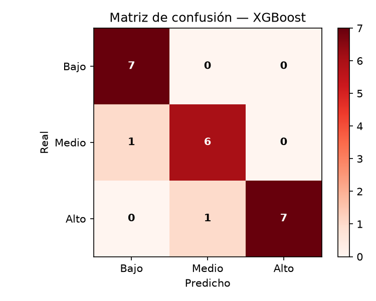

# 🌋 Plataforma de Riesgo Sísmico — Santander (Colombia)

> Clasificación del riesgo sísmico municipal y **priorización inteligente con Aprendizaje por Refuerzo**, con datos oficiales **SGC · DANE · UNGRD**.

<div style="display:flex;flex-wrap:wrap;gap:8px;margin:12px 0;">
  
  
  
  
  
</div>

**Responsive:** este README y el dashboard (`app.py`) están diseñados mobile-first. Todas las imágenes usan `width:100%; height:auto` y el dashboard usa `layout="wide"` + `use_container_width=True` + CSS con `@media (max-width:768px)`.

> 📄 Spec técnica completa: [`SPEC.md`](./SPEC.md) — contratos de datos, hiperparámetros, criterios de aceptación y spec responsive.

---

## 📊 KPIs actuales (87 municipios, 208.230 sismos)

| KPI | Valor |
|---|---|
| Sismos analizados | 208.230 |
| Magnitud máxima | 6.4 (Los Santos) |
| Población expuesta | 2.407.319 |
| Top riesgo | Piedecuesta 0.81 · Barrancabermeja 0.69 · Los Santos 0.68 |
| Clasificador ganador | **XGBoost** — Acc 0.9091 · F1-macro 0.9079 · F1-CV 0.6812 |
| Agente RL ganador | **DQN 9.857** vs PPO 9.135 (120 episodios) |
| Clustering | Aglomerativo_k3, silhouette 0.1999, ARI 0.4085 |

> Los Santos concentra 104.654 sismos (50,3% del total) pero es #3 en riesgo y #15 en RL: el RL premia riesgo + exposición, no solo conteo. Ver [¿Por qué Los Santos no es #1 en RL?](#-por-qué-los-santos-no-es-1-en-rl).

---

## 🏗️ Arquitectura

```text
project/
├─ data/raw/            # fuentes oficiales (ya descargadas)
├─ data/processed/      # dataset maestro, features, rankings, métricas
├─ models/              # clasificador + agente RL + metadatos
├─ rl/                  # entorno Gymnasium + agentes PPO/DQN
├─ src/
│  ├─ preprocessing/    # limpieza SGC, DIVIPOLA, población, emergencias, master
│  ├─ features/         # 30+ variables + índices de exposición/vulnerabilidad/riesgo
│  ├─ training/         # etiquetado + selección automática (RF/XGB/LGBM/GB)
│  ├─ evaluation/       # analítica, insights, gráficas
│  └─ utils/            # logging, validación, normalización
├─ scripts/run_pipeline.py
├─ app.py               # dashboard Streamlit (6 páginas, responsive)
└─ requirements.txt
```

---

## 🧠 Modelos explicados

### 1. Clasificador de riesgo (supervisado) — `src/training/train_classifier.py`

**Etiquetado:** `indice_riesgo` → `Bajo/Medio/Alto` por terciles `qcut(3)` (`src/training/label_risk.py`). 29/29/29 municipios balanceados.

**Evita fuga:** excluye `idx_actividad, indice_exposicion, indice_vulnerabilidad, indice_riesgo` del `X`. Aprende solo de 32 variables primarias (sismicidad, profundidad, temporalidad, población, emergencias, lat/lon).

**Candidatos (Pipeline `StandardScaler + clf`):**

| Modelo | F1-macro CV (5-fold estratificado) |
|---|---|
| **XGBoost** ✅ | **0.6812** |
| RandomForest | 0.6642 |
| LogisticRegression | 0.6530 |
| GradientBoosting | 0.6120 |
| LightGBM | 0.5995 |
| HistGradientBoosting | 0.5552 |

Protocolo: `train_test_split(75/25, stratify, seed=42)` + `StratifiedKFold(5)` en train. Se elige por **F1-macro CV**, se reporta en test `accuracy, precision_macro, recall_macro, f1_macro + matriz`.

**Top features (XGBoost):** `energia_sismica_acum 0.11 > pct_mag>5 0.078 > heridos 0.06 > cantidad_sismos 0.06 > poblacion_actual 0.057 > magnitud_maxima 0.048`.

#### Gráfica: matriz de confusión (test, 22 municipios)



```
Real\Pred   Bajo  Medio  Alto
Bajo          7      0      0
Medio         1      6      0
Alto          0      1      7
```
Solo 2 errores, ambos entre niveles adyacentes (Medio↔Alto/Bajo). No confunde Bajo con Alto.

### 2. Clustering (no supervisado) — `src/training/clustering.py`

Contraste sin etiquetas. Candidatos `KMeans k=3-6 + Aglomerativo_k3 + DBSCAN`, ganador por **silhouette**. Transformación `log1p` en variables con skew>1.5 (evita colapso por Los Santos outlier).

| Modelo | Silhouette |
|---|---|
| **Aglomerativo_k3** ✅ | **0.1999** |
| KMeans_k6 | 0.1603 |
| KMeans_k5 / k3 / k4 | ~0.14-0.15 |
| DBSCAN | -1.0 (colapsa) |

* 3 clústeres → mapeados a Bajo/Medio/Alto por `indice_riesgo` medio. `ARI vs supervisado 0.4085`, acuerdo 64.4%.
* Clúster 0 (Alto, 31 mpios: Los Santos, Zapatoca, Piedecuesta): `log_poblacion z=0.85, emergencias z=0.68`.
* Clúster 2 (Medio, 8 mpios: Cepita, Guaca, Jordán): `pct_mag>5 z=2.24` — pocos sismos pero grandes.

### 3. Priorización RL — `rl/env_sismo.py` + `rl/train_rl.py`

**Entorno `SismoPrioridadEnv` (Gymnasium):**
* 1 episodio = recorrer los 87 municipios en orden aleatorio.
* Estado = features normalizadas + `[frac, 1-frac]` (progreso del episodio).
* Acciones = `{0: no priorizar, 1: priorizar}`.
* Recompensa:
  ```
  R(1) = 2*r - 1 + 0.5*e*r
  R(0) = 0.3*(1-r) - 0.7*r
  r = indice_riesgo [0,1], e = indice_exposicion
  ```

**Agentes `rl/agents.py`:**
* `PolicyGradientAgent` (PPO-style, numpy): REINFORCE con baseline + clipping, red `obs→64 tanh→sigmoid`.
* `DQNAgent`: `MLPRegressor(64,32)` que aproxima `Q(s,a)`, replay buffer 5000, `gamma 0.95`, `epsilon 1.0→0.05`.
* Si hay `stable-baselines3+torch`, se entrena `PPO/DQN` real (8000 steps) y se compara.

**Evaluación:** recompensa media en 10 episodios nuevos deterministas. Gana el mayor → genera `ranking_rl.csv` con `score_rl_100 0-100`.

| Agente | Recompensa media |
|---|---|
| **DQN** ✅ | **9.857** |
| PPO | 9.135 |

Curva `data/processed/curva_rl.csv`: PPO sube rápido (~ep 20) y se estanca en ~7; DQN empieza negativo y lo supera desde ep ~90.

#### Gráfica sugerida: curva de aprendizaje RL

> Genera con: `python -c "import pandas as pd; df=pd.read_csv('data/processed/curva_rl.csv'); ..."` o verla en página RL del dashboard. PPO = aprendizaje rápido / techo bajo, DQN = lento / techo alto.

---

## 📈 Gráficas del dashboard (qué muestra cada página)

| Página | Gráficas |
|---|---|
| Inicio | 4 KPIs + tabla fuentes + `bar_chart(riesgo)` |
| Análisis Sísmico | `px.bar(sismos por año)` + `hist(mag)` + `hist(prof_km)` + `scatter_geo(5000 eventos)` + `bar Top-15 sismicidad` |
| Riesgo | 4 metrics + `bar_chart(F1-CV)` + tabla importancias + `matriz_confusion.png` + `scatter PCA-2D clusters` + tabla filtrable |
| RL | banner ganador + tabla Top-20 + `bar Top-15 score_rl_100 coloreado por indice_riesgo` |
| Mapas | Folium: `CircleMarker` radio `4+10*riesgo`, color `Alto=red/Medio=orange/Bajo=green` + 2000 sismos `darkred` |
| Insights | 8 insights auto + Top-10 riesgo + Top-10 RL |

Todas usan `use_container_width=True` → responsive.

---

## 👀 Cómo se ve (responsive)

> Guarda capturas en `docs/img/` y se verán solas. En móvil se apilan a 1 columna gracias al CSS de `app.py`.

<div style="display:flex;flex-wrap:wrap;gap:12px;">
  <div style="flex:1 1 300px;min-width:260px;">
    <b>1. Inicio</b><br/>
    
    <sub>KPIs + fuentes SGC/DANE/UNGRD + distribución Bajo/Medio/Alto</sub>
  </div>
  <div style="flex:1 1 300px;min-width:260px;">
    <b>2. Riesgo + Matriz</b><br/>
    
    <sub>XGBoost Acc 0.90, solo 2 errores adyacentes</sub>
  </div>
  <div style="flex:1 1 300px;min-width:260px;">
    <b>3. Mapas Folium</b><br/>
    
    <sub>Círculos proporcionales al riesgo sobre Santander [6.9,-73.3]</sub>
  </div>
</div>

Para reemplazar por capturas reales:
```bash
# 1. corre el dashboard
streamlit run app.py
# 2. captura cada página (Win+Shift+S) y guarda como:
docs/img/01-inicio.png
docs/img/02-sismico.png
docs/img/03-riesgo.png
docs/img/04-rl.png
docs/img/05-mapas.png
docs/img/06-insights.png
```
Luego cambia los `src` de arriba de `matriz_confusion.png` a `docs/img/0X-*.png`. El `style="width:100%..."` ya los hace responsive.

---

## ❓ Por qué Los Santos no es #1 en RL

Los Santos = 104.654 eventos pero `pob 15k, exposicion 0.40`. Bucaramanga = 241 eventos pero `pob 627k, exposicion 0.99`. El RL optimiza `riesgo+exposición`, no conteo. Además el ranking actual está empatado (33 mpios en 100.0): del puesto 1 al 33 no hay diferencia real. Ver `ranking_rl.csv` y `analitica.json:top10_riesgo` (Los Santos #3 en riesgo).

---

## 🚀 Uso

```bash
pip install -r requirements.txt
python scripts/run_pipeline.py --episodes 120
streamlit run app.py
```

> Solo `pandas+numpy+scikit-learn` obligatorios. `xgboost, lightgbm, gymnasium, stable-baselines3, torch` opcionales con fallback numpy.

## Fases

1. **Procesamiento**: SGC 1993-2018 + 2018-hoy, join haversiano si no matchea DIVIPOLA, llave = DIVIPOLA.
2. **Features**: 30+ vars + `indice_exposicion, indice_vulnerabilidad, indice_riesgo`.
3. **Clasificación**: terciles + selección por F1-CV + matriz.
4. **RL**: Gymnasium priorizar/no, PPO vs DQN, ranking 0-100.
5. **Analítica**: Top-10s + insights.
6. **Dashboard**: 6 páginas responsive (Inicio, Sísmico, Riesgo, RL, Mapas, Insights).
