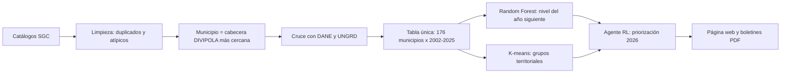

# Sismos Santander

Página web para presentar el análisis de la actividad sísmica de los municipios de Santander hecho por el equipo en [Hackathon-uts](https://github.com/JuanCastellanos1/Hackathon-uts). Muestra los resultados reales del pipeline (modelo supervisado, agrupamiento y agente de aprendizaje por refuerzo) y genera boletines en PDF por municipio.

> **Este sistema no predice sismos.** Ningún método científico puede anunciar hoy cuándo, dónde y de qué magnitud ocurrirá un sismo. El nivel que se muestra es una estimación estadística de la actividad del año siguiente a partir del historial; puede fallar y no reemplaza la información del SGC, la UNGRD ni los consejos de gestión del riesgo.

## Equipo

| Integrante | Rol |
|---|---|
| _Nombre_ | _Rol_ |
| _Nombre_ | _Rol_ |
| _Nombre_ | _Rol_ |

## Cómo usarlo

Abrir `index.html` en Chrome, Edge o Firefox. No necesita servidor ni instalación: los resultados del equipo vienen incluidos en `data/resultados_equipo.js`. Se necesita internet para las librerías, las fuentes y la imagen satelital.

Secciones (menú lateral, se oculta con ☰; modo oscuro con el botón de sol/luna):

- **Mapa de riesgo:** los 87 municipios coloreados por el nivel previsto para 2026, los priorizados por el agente con borde grueso, las fallas activas y la lista de municipios con posible riesgo.
- **Clasificación:** métricas del modelo supervisado frente a las líneas base, niveles, matriz de confusión, importancia de variables y una prueba de entrada → resultado por municipio con su serie de sismos.
- **Grupos territoriales:** elección de k, perfiles de los grupos, comparación con los departamentos vecinos, fuentes sísmicas (DBSCAN) y mapa.
- **Priorización:** formulación del agente (entorno, estado, acción, recompensa), comparación con las líneas base, curva de aprendizaje, pesos de la política, mapa y ranking 2026. K se puede mover entre 5 y 20.
- **Boletines:** filtros por nivel, prioridad, grupo o nombre, y descarga del PDF de cada municipio o del boletín departamental.
- **Datos y variables:** fuentes oficiales con su URL y fecha de descarga, flujo de datos y diccionario con la justificación de cada variable.

## Fuentes

| Fuente | Qué aporta |
|---|---|
| SGC, Red Sismológica Nacional ([catálogo 1993–2018](https://bdrsnc.sgc.gov.co/paginas1/catalogo/Consulta_Experta/consultaexperta_2.php) y [SeisComP 2018–hoy](https://bdrsnc.sgc.gov.co/paginas1/catalogo/Consulta_Experta_Seiscomp/consultaexperta.php)) | 222.085 sismos de la caja de Santander y vecinos (lat 5,7–8,2; lon −74,6 a −72,4), descargados el 13-oct-2026 |
| [DANE, DIVIPOLA](https://www.datos.gov.co/resource/gdxc-w37w.csv) | Códigos y coordenadas de las cabeceras municipales |
| [DANE, proyecciones de población 2020–2035](https://www.dane.gov.co/files/censo2018/proyecciones-de-poblacion/Municipal/DCD-area-proypoblacion-Mun-2020-2035-ActPostCOVID-19.xlsx) | Población y % rural por municipio (2020) |
| UNGRD, emergencias ([2019–2024](https://www.datos.gov.co/resource/wwkg-r6te.csv), [2025](https://www.datos.gov.co/resource/2343-nuqp.csv)) | Emergencias, movimientos en masa y viviendas afectadas por municipio |
| Límites municipales ([santiblanko/colombia.geojson](https://github.com/santiblanko/colombia.geojson), cartografía IGAC/DANE) | Polígonos de los 87 municipios para los mapas y boletines |
| [GEM Global Active Faults](https://github.com/GEMScienceTools/gem-global-active-faults) (Active Tectonics of the Andes y SARA; CC BY-SA 4.0) | Fallas activas en los mapas y la falla más cercana de cada boletín |
| [Esri World Imagery](https://www.arcgis.com/home/item.html?id=10df2279f9684e4a9f6a7f08febac2a9) y OpenStreetMap | Mapa base satelital y de calles |

## Método (resumen del pipeline del equipo)



- **Niveles:** según los sismos de magnitud 2,5 o más del año siguiente: bajo (0), medio (1 a 4) y alto (5 o más).
- **Validación temporal:** entrenamiento 2002–2015, validación 2016–2019 y prueba 2020–2024. Líneas base: clase mayoritaria y persistencia.
- **Agrupamiento:** K-means sobre el perfil sísmico 2002–2025, con k elegido por silueta, y DBSCAN para ubicar las fuentes sísmicas.
- **Agente RL:** política lineal softmax entrenada por gradiente de política con 10 semillas. Elige K municipios por año; la recompensa es la amenaza real del año siguiente × (exposición + vulnerabilidad) / 2. Se compara con el azar, la mayor población, la mayor actividad pasada, el ranking supervisado y un índice de pesos iguales.

Las cifras exactas se ven en la página (se leen de los JSON del equipo, no están escritas a mano).

## Boletines

Cada PDF trae: el aviso de que el sistema no predice sismos y la lista de lo que no puede predecir, población DANE, nivel previsto para 2026 con sus probabilidades, actividad sísmica reciente (2025, últimos 12 meses, último sismo y el más fuerte desde 1993), mapa satelital del municipio con su límite, los epicentros del último año y las fallas activas, prioridad y su confianza, emergencias UNGRD, evacuación, recomendaciones de antes, durante y después, y líneas de emergencia (123, Bomberos 119, Cruz Roja 132, Defensa Civil 144).

No hay un dato oficial abierto con las rutas de evacuación de cada municipio, así que no se inventan: el boletín da pautas generales y remite al plan del Consejo Municipal de Gestión del Riesgo. Si el equipo consigue puntos de encuentro reales, se cargan en Datos y variables con la plantilla `data/plantilla_evacuacion.csv`.

Los boletines no llevan escudos oficiales porque no los emite la Gobernación ni las alcaldías: dicen "Elaborado por [equipo] con datos oficiales de SGC, DANE, UNGRD e IGAC" y llevan el sello "Documento académico, no oficial". El nombre del equipo se cambia en `NOMBRE_EQUIPO` (`js/boletines.js`).

## Actualizar los datos

Si el pipeline cambia, se vuelve a exportar con (desde la raíz del repo Urielitos-main):

```bash
$env:PYTHONPATH="<repo>"
py -3.11 scripts/exportar_frontend.py
```

El script lee los CSV/JSON de `data/processed`, los modelos de `models/` (clasificador y agente RL con sus probas y rankings reales) y los metadatos de `data/raw`, y escribe `sismos-santander/data/resultados_equipo.js` con el formato que lee la página: 87 municipios, serie anual 1993–2026, predicción Bajo/Medio/Alto con probabilidades, priorización RL con oráculo top-K y líneas base, métricas con bootstrap, clustering aglomerativo + fuentes DBSCAN, curva de aprendizaje y 90.367 eventos M ≥ 2,0 compactos. Sin servidor ni API.

## Supuestos y limitaciones

- No predice sismos: estima niveles de actividad anual y prioriza preparación.
- La recompensa del agente aproxima el impacto con energía sísmica, población y emergencias pasadas; no incluye la vulnerabilidad estructural ni el tipo de suelo.
- El catálogo cambió de red en 2018; por eso se usa M ≥ 2,5 como magnitud de completitud conservadora.
- Cada sismo se asigna a la cabecera municipal más cercana, no al límite real del municipio. Por eso una ciudad como Bucaramanga puede tener pocos sismos aunque el Nido esté cerca.
- La población es la proyección DANE 2020 y las emergencias cubren 2019–2025; se usan como datos fijos del municipio.
- Las fallas vienen de una base científica internacional (GEM), no del mapa oficial del SGC.

## Estructura

```
index.html                     página
css/estilos.css                diseño (modo claro y oscuro, paleta de Santander)
js/app.js                      secciones, mapas y gráficas
js/boletines.js                filtros y boletines PDF
js/utilidades.js               funciones generales
data/resultados_equipo.js      resultados del pipeline y sismos de Santander (generado)
data/municipios_geo.js         límites de los 87 municipios
data/fallas_activas.js         fallas activas recortadas a la zona
data/plantilla_evacuacion.csv  plantilla de puntos de encuentro
herramientas/exportar_web.py   exporta los resultados del pipeline a la página
docs/mockups/                  capturas de la interfaz y un boletín de ejemplo
```

Librerías por CDN: [Chart.js](https://www.chartjs.org), [Leaflet](https://leafletjs.com) y [jsPDF](https://github.com/parallax/jsPDF).
